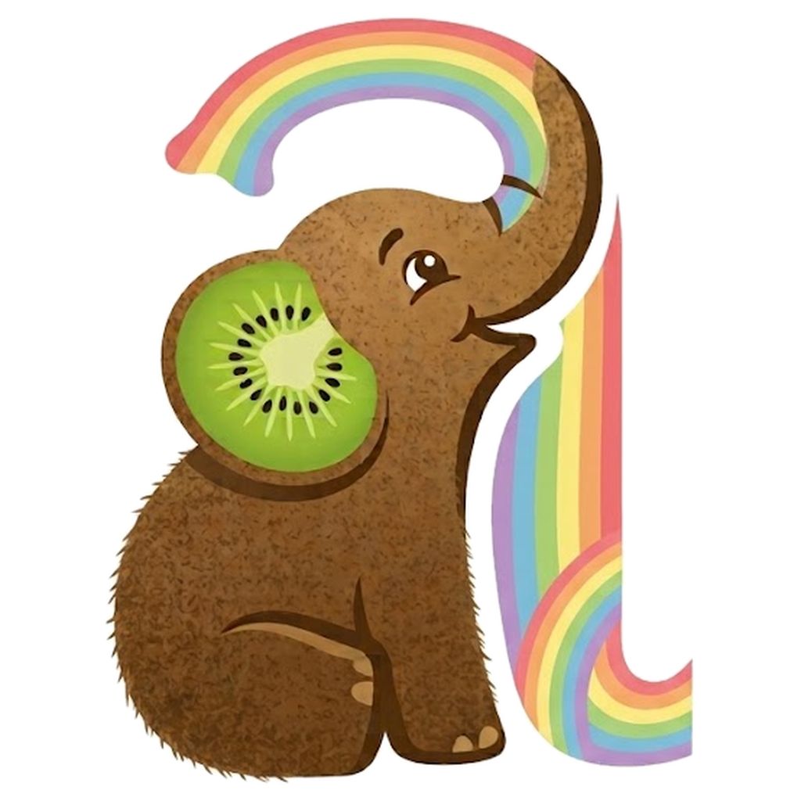

# Aquenda: direção visual

Tudo sai da logo: um elefantinho com a pele de casca de kiwi e a orelha de kiwi cortado, que levanta a tromba e desenha a letra "a" com um arco-íris pastel. A arte original está em `assets/logo-original.png`; `scripts/logo/recortar.py` tira o fundo e gera o ícone, o ícone adaptativo e monocromático do Android, a abertura e o mascote usado dentro do app. O app tem o mesmo jeito: ilustração de livro infantil, acolhedor, com pouco texto. As referências que guiaram o resto foram o Headspace (uma cor forte por seção, título curto, uma ação por tela) e o Finch (formas macias, autocuidado sem pressa). Os tokens estão em `src/tema/tokens.ts`.

## Cor

| Papel | Claro | Para quê |
|---|---|---|
| papel | `#FFFFFF` | fundo, como o fundo da logo |
| superfície | `#F7F2EC` | campos, bolhas do chat, blocos |
| tinta | `#3A2A1F` | texto: o marrom da casca do kiwi |
| tinta suave | `#6B5847` | texto de apoio |

Cada aba pega um tom do arco-íris da tromba. Juntas, as seis formam o arco inteiro, a comunidade toda, sem destacar uma bandeira só:

| Aba | Tom | Topo | Ação |
|---|---|---|---|
| Rodas e salas | coral | `#FBD6D5` | `#AC3636` |
| Casa | laranja | `#FFDDBE` | `#A84B0C` |
| Rolês | amarelo | `#FCEDB3` | `#856000` |
| Saúde | verde-kiwi | `#DCEFBF` | `#4A7314` |
| Vagas | azul | `#D3E5F7` | `#2C61A3` |
| Agenda | lilás | `#E6DCF6` | `#6547AA` |

O topo é o tom claro (texto marrom por cima); botões e chips ativos usam o tom escuro (texto branco). Tem modo escuro com os mesmos papéis. Todos os pares, nos dois temas e nas seis abas, passam de 4,5:1 (`__tests__/contraste.test.ts`).

## Tipo

- **Fredoka** (redonda) só nos títulos: conversa com o traço gordinho da logo.
- **Atkinson Hyperlegible** em todo o resto: feita pelo Braille Institute para baixa visão.

Corpo de 17 pt, e tudo cresce com o tamanho de fonte do celular.

## Forma

- **Topo de cada aba**: o tom da aba com a borda de baixo bem arredondada (36) e, no canto, um **arco-íris pastel** igual à tromba, começando pela cor da aba.
- **Listas sem caixa**: cada lugar é uma linha (nome, bairro, um selo só) com a setinha. Nada de cartão com borda e sombra em volta de tudo.
- **Pílulas**: botões e chips são redondos; blocos de destaque têm raio 24.
- O **mascote** aparece na abertura da aba Casa, nas telas vazias ("Nada por aqui") e na entrada das salas.

## Escrita

Pouco texto. Título curto ("Trabalho", "Agenda", "Do que você precisa?") e uma linha de apoio no máximo. O "como entrar" de cada serviço só aparece no detalhe, em destaque. Botão começa com verbo. Linguagem neutra quando precisa ("chamade", "encaminhade"). Erro diz o que houve e o que fazer.

## O que evitamos

Rótulo em caixa alta, numeração decorativa, seta em botão, uma palavra colorida no título, gradiente, a mesma sombra cinza em tudo e os combos "creme com terracota" ou "preto com verde-limão".
