# Aquenda · App mobile (Mobile Development & IoT)

App do **Aquenda**, a CitizenTech do grupo na Global Solution FIAP 2026.2 (Engenharia de Software, 3º ano).
Esta é a entrega de **Mobile Development & IoT**: o app em React Native + TypeScript + Expo que é a porta de entrada da solução. Ele consome as duas APIs do grupo, guarda a agenda de hormônio e consultas só no celular e tem modo discreto.

## Ficha da CitizenTech

| Campo | Conteúdo |
|---|---|
| Nome | Aquenda |
| Cidade e bairro | São Paulo, com foco no Centro (República, Arouche) e nas regiões dos Centros de Referência LGBTI+ |
| Cidadão beneficiado | Pessoa LGBTQIAPN+ em São Paulo, principalmente trans, travesti ou em vulnerabilidade social |
| Problema, em uma frase | Os serviços de acolhimento, saúde, defesa e trabalho existem, mas estão espalhados, e quem precisa não sabe onde fica o mais próximo nem se será bem atendide |
| Como funciona | App que mostra serviços perto da pessoa (acolhimento, saúde trans, jurídico), vagas afirmativas, salas de conversa moderadas e rolês LGBT+, com agenda de hormônio guardada só no celular |
| O que cada parte faz | **App Expo (porta de entrada)** · API C# (catálogo, rodas, vagas das casas) · FastAPI (vagas de emprego e sync CNES) · ESP32 (ocupação das casas) · ML (desertos de cuidado) · VM Linux (hospedagem) · módulo PII (segurança) |
| Link do repositório | https://github.com/Lynnbrosa/GS-MOBILE-AQUENDA (API C#: https://github.com/Lynnbrosa/GS-c--AQUENDA · FastAPI: https://github.com/Lynnbrosa/GS-SOA-AQUENDA) |
| Indicador de impacto | Buscas que terminam em "como chegar" ou "ligar" e tempo até achar um serviço, medidos sem guardar quem buscou |
| ODS conectados | 10 Redução das desigualdades · 3 Saúde e bem-estar · 11 Cidades e comunidades sustentáveis |

**Integrantes:**

| Nome | RM |
|---|---|
| Giovanne Charelli Zaniboni Silva | 556223 |
| Gustavo Oliveira de Moura | 555827 |
| Lynn Bueno Rosa | 551102 |

O nome vem do pajubá, a linguagem criada e mantida pela comunidade travesti: *aquenda* é prestar atenção, olhar por alguém.

**Vídeo (até 3 min):** _link a adicionar_ · roteiro no fim deste README.

## O que o app faz

| Aba | O que tem | De onde vem |
|---|---|---|
| **Casa** | Casas de acolhimento, Centros de Referência LGBTI+ e jurídico. Busca por texto ou bairro, "Aberto agora", "Perto de mim" (do mais perto para o mais longe) e **vagas agora** de cada casa, que vêm do ESP32. Lugares salvos aparecem aqui. | API C#: `/api/servicos`, `/api/casas` |
| **Saúde** | Rede SAMPA Trans, hormonização e saúde mental, com "Por onde começar" (UBS). Abaixo, as unidades **habilitadas no processo transexualizador do SUS** (30.01, 30.02, 30.03), filtráveis por habilitação. | API C#: `/api/servicos?categoria=Saude` · FastAPI: `/api/municipios/3550308/estabelecimentos`, `/api/cnes/estabelecimentos/{codigo}` |
| **Vagas** | Vagas afirmativas (Gupy, Adzuna, Transcidadania, TransEmpregos) com filtros de texto, cidade, modalidade e "só afirmativas". O detalhe mostra **por que a vaga é afirmativa** (o trecho do anúncio, `termo_afirmativo`) e o botão abre a candidatura **no site de origem** (`url_candidatura`). | FastAPI: `/api/vagas`, `/api/vagas/{id}` |
| **Agenda** | Lembretes de hormônio (todo dia, dias da semana ou a cada N dias) e consultas com aviso antes. Notificação local no horário que a pessoa escolheu, "Marcar como feito" e histórico. **Nada sai do celular e o app não sugere dose.** | expo-sqlite + expo-notifications |
| **Rodas** (Conversa) | **Salas de conversa em tempo real**: primeiro emprego, transição, família e recém-chegades a SP. Só 18+, só apelido, sem conversa privada, moderadas por ONG. Segurar uma mensagem abre **denunciar** (1 toque; com 3 denúncias some) ou **bloquear** (só no seu celular). Abaixo, as rodas presenciais. | API C#: `/api/chat/...` e SignalR em `/hubs/chat`; `/api/rodas` |
| **Rolês** | Bares, baladas e espaços LGBT+ da curadoria e do OpenStreetMap (tag `lgbtq`, importada pela API C#), com "Aberto agora" e **mapa**. | API C#: `/api/servicos?categoria=Role` · mapa OpenStreetMap |

Casa e Rolês têm o botão **Mapa** (OpenStreetMap com Leaflet, sem chave; endereço protegido nunca entra no mapa). Em todo serviço: **Como chegar**, **Ligar** e **Abrir site** contam um toque no indicador de impacto (`POST /api/metricas/interacoes`, só tipo e id do serviço), e **Avisar que fechou** manda `POST /api/servicos/{id}/avisos-fechamento`.

**Se uma API cair**, cada tela mostra o último dado guardado no celular com uma faixa "Sem conexão com o serviço agora. Você está vendo o que foi guardado hoje às 14h05". Se nunca houve dado guardado, a tela explica o que aconteceu e oferece "Tentar de novo". Nunca fica uma tela vazia sem explicação.

**Modo discreto** (Ajustes): o ícone e o nome na tela inicial viram **Clima**, o app abre numa previsão do tempo e as notificações ficam neutras ("Lembrete", sem o nome). Há **PIN** (4 a 6 números, com espera crescente depois de 5 erros) e o botão **Sair**, no topo de todas as abas, que troca na hora para a tela de clima. Para voltar: tocar e segurar no nome da cidade.

## Como rodar

Pré-requisitos: Node 20+, Android Studio com um emulador (ou um celular Android com depuração USB) e as duas APIs rodando. A API C# precisa estar na versão com o chat (commit `63e4421` ou mais nova da branch `rinku/loving-planck-r47bz4`).

1. Suba as APIs (cada uma no seu repositório):

```bash
dotnet run --project src/Aquenda.Api
```

```bash
uvicorn app.main:app --host 0.0.0.0 --port 8000
```

O `--host 0.0.0.0` só é necessário para o celular físico enxergar a FastAPI. A API C# já escuta em `0.0.0.0:5000`.

2. Instale e rode o app:

```bash
npm install
```

```bash
npx expo run:android
```

O app usa módulos nativos (troca de ícone, armazenamento seguro), então roda num *development build*, não no Expo Go. O primeiro build demora alguns minutos; depois, `npx expo start` basta.

**No Windows**, se o projeto estiver numa pasta funda (ex.: Desktop), o C++ do `react-native-reanimated` passa do limite de 260 caracteres de caminho e o build falha com `ninja: error: mkdir`. O script abaixo copia o projeto para `C:\aq`, compila lá e instala no emulador:

```bash
powershell -ExecutionPolicy Bypass -File scripts/build-android-local.ps1
```

Com `-Release`, gera um APK que roda sozinho (sem o Metro) em `dist-apk/`.

### Endereço das APIs

| Onde | O que o app usa sem configurar nada |
|---|---|
| Emulador Android | `http://10.0.2.2:5000` e `http://10.0.2.2:8000` (o computador visto de dentro do emulador) |
| Celular físico na mesma rede | o IP do computador que roda o Metro, por exemplo `http://192.168.0.12:5000` |

Para fixar outro endereço, copie `.env.example` para `.env`:

```
EXPO_PUBLIC_API_CSHARP_URL=http://192.168.0.12:5000
EXPO_PUBLIC_API_SOA_URL=http://192.168.0.12:8000
```

Ou troque na hora em **Ajustes → Endereço dos serviços** (fica salvo no SQLite do celular).

### Testes

```bash
npm test
```

```bash
npm run typecheck
```

167 testes Jest, sem rede: o `jest.setup.ts` faz qualquer `fetch` não preparado falhar. Os clientes das APIs são testados contra **respostas gravadas das APIs reais** em `__tests__/respostas` (06/11/2026, depois de sincronizar a FastAPI com a Gupy, o CNES e o IBGE).

| Arquivo | O que testa |
|---|---|
| `agenda.test.ts` | próximas ocorrências (diária, semanal, a cada N dias, virada do ano), validação, gatilhos do expo-notifications, texto neutro no modo discreto, aviso de consulta, datas e horas digitadas |
| `clientes.test.ts` | URLs com filtros, leitura das respostas gravadas das duas APIs, ProblemDetails, 204, rede fora |
| `cache.test.ts` | dado novo é guardado; API fora mostra o guardado com a data; sem nada guardado dá erro explicado; 404 não usa versão velha |
| `formato.test.ts` | "há 5 minutos", "amanhã às 08h30", distâncias, links de telefone e mapa, recusa de `javascript:` |
| `config-pin-clima.test.ts` | escolha do endereço (env, emulador, celular físico, Ajustes), regras do PIN, previsão da tela de clima |
| `conversa.test.ts` | salas: juntar mensagens do tempo real, ocultar, bloquear por apelido, mesmas regras de link/telefone/e-mail/CPF da API, e o cliente do `/api/chat` contra respostas gravadas (regras, salas, entrar, 18+, enviar, 401, 422, denúncia) |
| `contraste.test.ts` | todos os pares de cor dos dois temas e das seis abas passam de 4,5:1 |

## Telas

| | | |
|---|---|---|
| 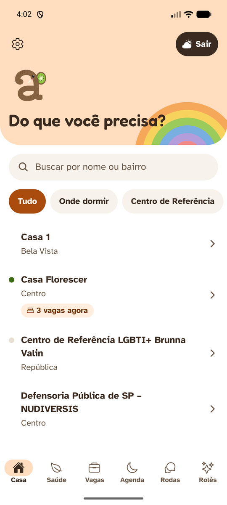 Casa, com vagas agora | 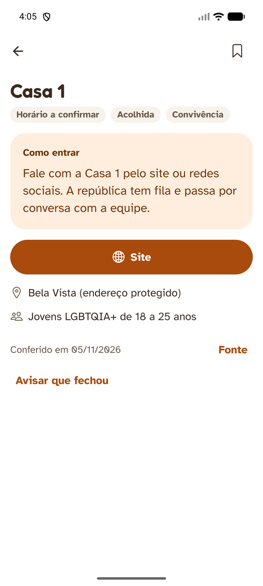 Detalhe e "como entrar" | 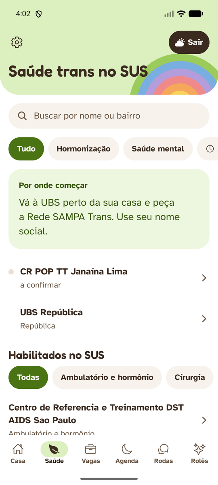 Saúde e CNES |
| 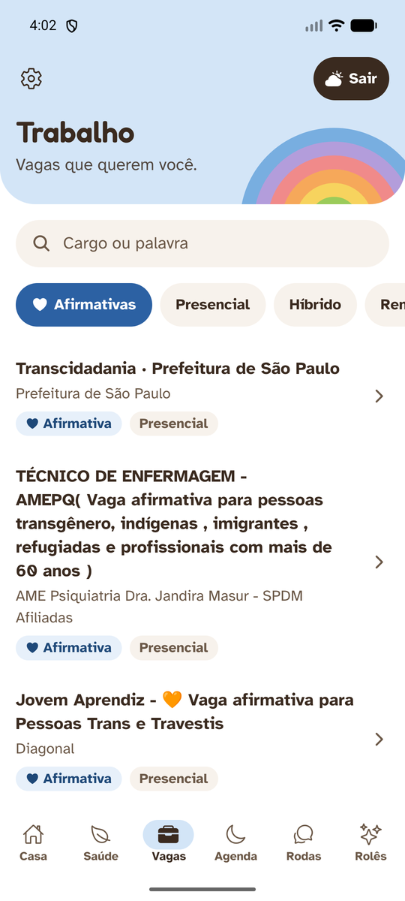 Vagas afirmativas |  Por que é afirmativa | 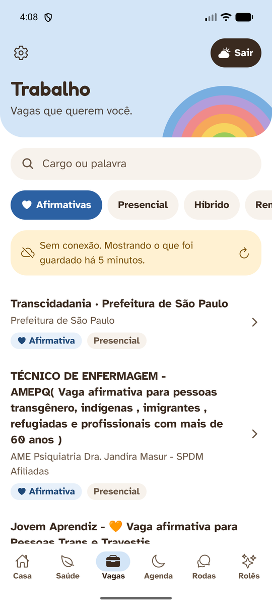 API fora: dado guardado |
| 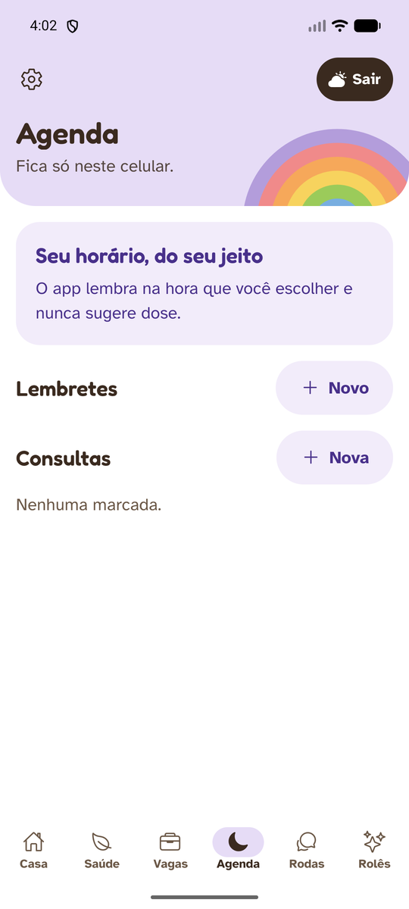 Agenda | 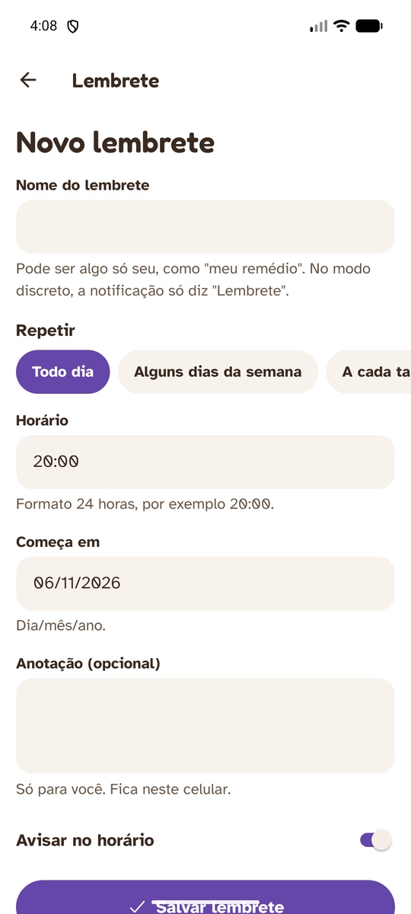 Novo lembrete | 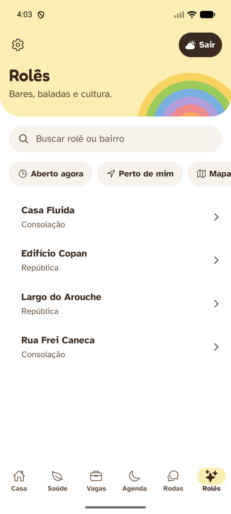 Rolês |
| 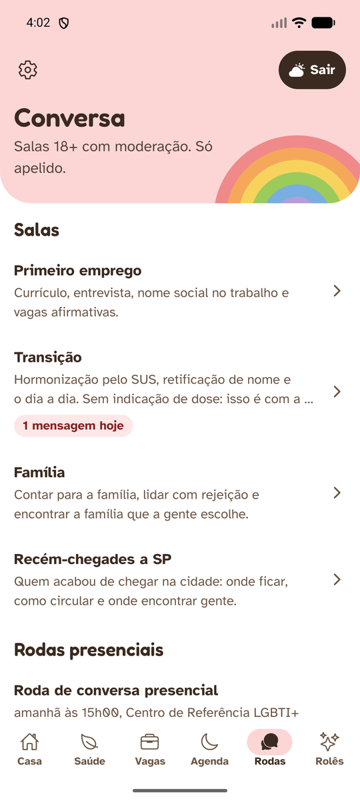 Salas e rodas | 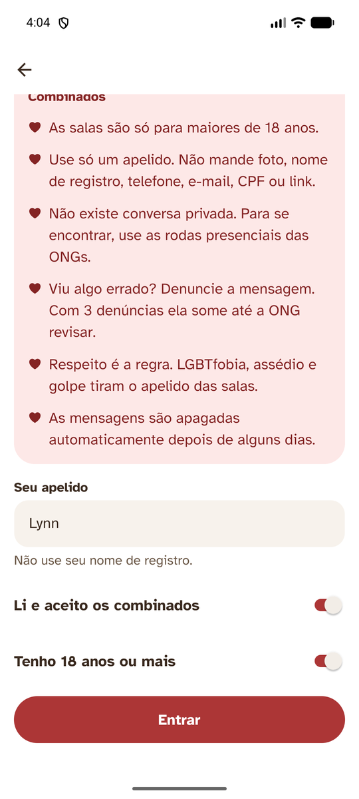 Combinados, apelido e 18+ | 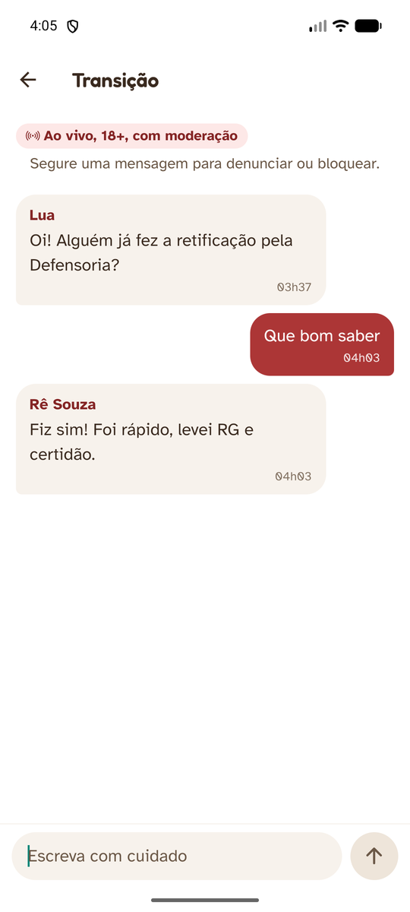 Sala ao vivo |
| 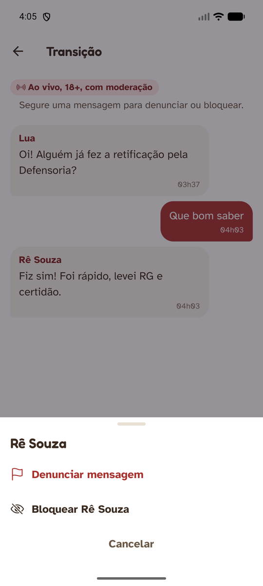 Denunciar ou bloquear | 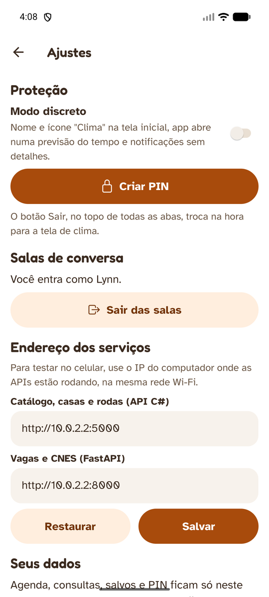 Ajustes | 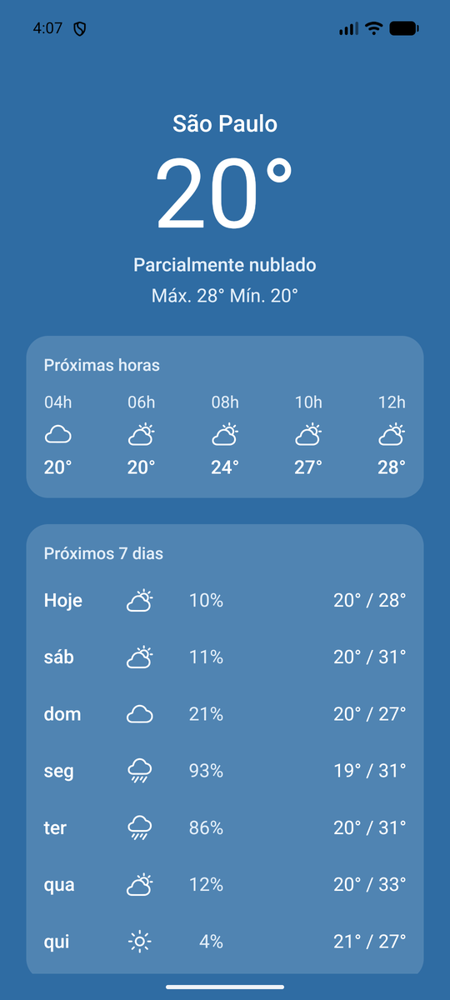 Saída rápida |

## Onde cada critério da rubrica aparece

| Critério | Onde ver |
|---|---|
| **Telas e navegação** | Expo Router em `src/app`: `(abas)/_layout.tsx` com as 6 abas do pitch, um `Stack` em `_layout.tsx` com os detalhes (`servico/[id]`, `vaga/[id]`, `cnes/[codigo]`, `roda/[id]`), os formulários da agenda em modal, Ajustes e a tela de clima. Rotas tipadas (`typedRoutes`). |
| **Consumo de dados** | `src/lib/api`: `http.ts` (fetch com tempo limite, cabeçalhos e ProblemDetails), `csharp.ts`, `chat.ts` e `soa.ts` com todos os endpoints pedidos, `tipos.ts` com os contratos das duas APIs. Tempo real das salas com SignalR em `src/lib/tempoReal.ts` (com consulta de reserva se a conexão cair). `src/estado/useRecurso.ts` mostra o guardado na hora, atualiza pela rede e avisa quando o dado é antigo. Endereços configuráveis em `src/lib/config.ts`. |
| **Banco de dados** | `src/lib/banco.ts`: expo-sqlite com migração por `PRAGMA user_version`, tabelas `lembretes`, `registros`, `consultas`, `favoritos`, `bloqueados`, `preferencias` e `cache_api`, consultas parametrizadas e transação. O PIN fica como hash SHA-256 com sal no `expo-secure-store` (`src/lib/discreto.ts`), e o token das salas também fica lá (`src/lib/participante.ts`). |
| **Acessibilidade** | Rótulos e dicas de leitor de tela em todo botão e cartão (o cartão lê nome, distância, se está aberto e as vagas numa frase só), `accessibilityRole`, `accessibilityState` nos chips, regiões "live" para avisos e erros. Fonte Atkinson Hyperlegible que cresce com o tamanho do sistema, alvos de toque de 48 dp ou mais, teclado de PIN com teclas de 72 dp, contraste AA testado nos temas claro e escuro, linguagem simples. Ver `src/componentes/base.tsx` e `DESIGN.md`. |
| **Aderência ao problema** | Cada serviço diz **como entrar** ("vá à sua UBS e peça encaminhamento"); endereço de casa de acolhimento é protegido; vagas mostram por que são afirmativas e mandam para o site de origem; salas de conversa 18+ moderadas, sem conversa privada e sem troca de contato; agenda só no celular e sem sugerir dose; modo discreto com ícone "Clima", PIN e saída rápida; indicador de impacto anônimo. |
| **Documentação** | Este README (ficha, como rodar, telas, rubrica, roteiro), `DESIGN.md` com a direção visual, comentários nos módulos explicando as decisões. |

## Organização

```
src/
  app/                   telas (Expo Router)
    (abas)/              casa, saúde, vagas, agenda, rodas, rolês
    servico/ vaga/ cnes/ roda/   detalhes
    agenda/              formulários de lembrete e consulta
    ajustes.tsx clima.tsx _layout.tsx
  componentes/           base (texto, botões, cartões, fita, avisos), Tela, BuscaServicos, PIN
  estado/                Sessao (discreto, PIN, bloqueio), useRecurso (API + cache)
  lib/
    api/                 cliente HTTP, API C#, FastAPI, tipos
    agenda.ts            regras da agenda (lógica pura)
    banco.ts             expo-sqlite
    cache.ts             regra do "último dado guardado"
    notificacoes.ts      expo-notifications
    discreto.ts pin.ts   PIN e troca de ícone
    formato.ts clima.ts config.ts localizacao.ts
  tema/                  tokens de cor, tipo e espaço
plugins/with-rotulo-discreto.js   nome "Clima" junto com o ícone no Android
scripts/gerar-icones.py           gera os ícones de assets/
__tests__/                         testes e respostas gravadas
```

## Decisões de privacidade

- **Agenda, consultas, salvos e PIN nunca saem do celular** (contrato do grupo). As notificações são locais.
- **Posição:** só quando a pessoa toca em "Perto de mim", vai na busca com 4 casas decimais e não é guardada.
- **Métricas sem pessoa:** o app manda só o tipo do toque e o id do serviço.
- **Links:** o app só abre `http(s)`, então um anúncio com `javascript:` não passa.
- **Salas:** só apelido. O token fica no armazenamento seguro; bloquear alguém fica só no seu celular. O app avisa antes de enviar link, telefone, e-mail ou CPF (a API recusa de qualquer jeito).
- **Apagar meus dados** (Ajustes) apaga o banco, o PIN, o token das salas e as notificações agendadas.

## Roteiro do vídeo (3 min)

1. **0:00–0:20** · Abertura: o problema em uma frase e o nome Aquenda (pajubá: olhar por alguém).
2. **0:20–0:55** · Aba Casa: filtrar "Onde dormir", ver a Casa Florescer com "3 vagas agora" (ESP32 → API C#), abrir o detalhe e mostrar o "Como entrar" e o endereço protegido. Tocar em "Como chegar" num Centro de Referência.
3. **0:55–1:20** · Saúde: "Por onde começar" e as unidades habilitadas no SUS vindas do CNES pela FastAPI.
4. **1:20–1:45** · Vagas: filtro "só afirmativas", abrir uma vaga, mostrar "Por que é afirmativa" e o botão que abre o site de origem.
5. **1:45–2:15** · Agenda: criar um lembrete a cada 14 dias e mostrar a notificação chegando. Dizer que fica só no celular e o app não sugere dose.
6. **2:15–2:30** · Conversa: entrar numa sala com apelido, mandar uma mensagem e ver a de outra pessoa chegar ao vivo. Segurar e mostrar denunciar/bloquear.
7. **2:30–2:45** · Derrubar a FastAPI e voltar em Vagas: aparece a faixa com o dado guardado e a hora.
8. **2:45–3:00** · Modo discreto: ícone "Clima" na tela inicial, PIN, "Sair" e voltar segurando o nome da cidade.
